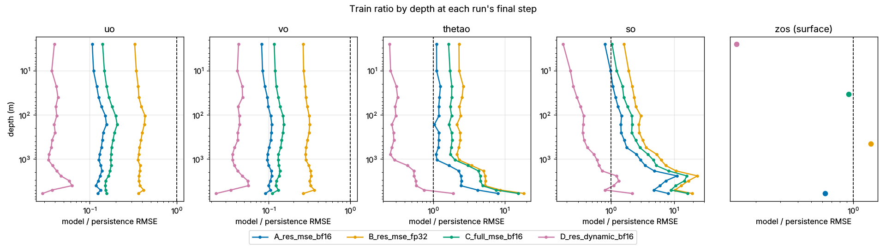
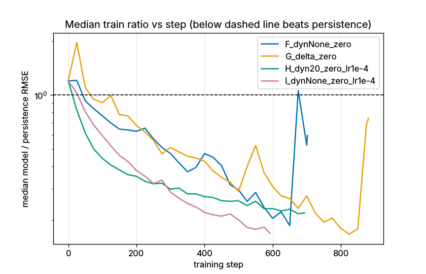
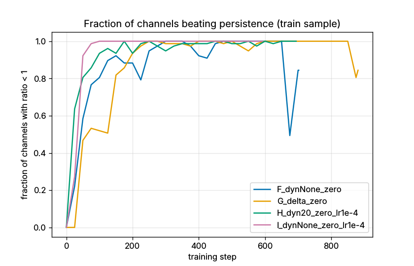
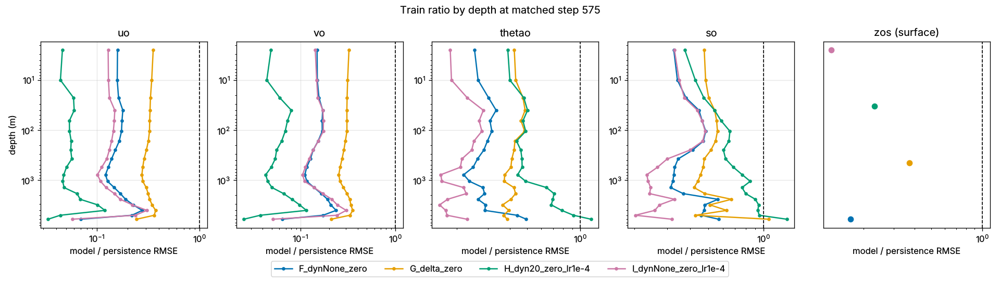

<!-- SPDX-FileCopyrightText: 2026 Samudra Authors -->
<!-- SPDX-License-Identifier: CC-BY-4.0 -->

# Can Samudra overfit one sample? (1°, CPU)

**Answer: yes.** Round 1 (below) got to 94% of channels with the paper's loss.
Round 2 got every channel under persistence by changing the loss weighting,
zero-initialising the decoder and lowering the learning rate. See
[Round 2](#round-2-zero-init-decoder-and-deep-channel-weighting).

Experiment record, not intended to merge. Follows up the one-step report in
m2lines/Samudra#980 (`onestep_figures_onedeg.md`), which found Samudra 2's
temperature and salinity error sits at a ~2–4%-of-a-spread "precision floor"
and loses to persistence below the surface.

**Question.** If the architecture is asked to memorize a single 1° sample, can
it beat persistence on every channel? If it can't even do that, the floor is
about the model or its numerics. If it can, the floor in the paper checkpoint
is about the training objective and task.

## Setup

- **Model:** the paper Samudra architecture (`samudra_om4/model.yaml`: ConvNeXt
  U-Net, widths 280–520, 84M params). 2 input steps, 2 output steps, activation
  checkpointing on.
- **Data:** public v2026-09 `om4_onedeg` store, 40 steps cloned (1975-01-03 to
  1975-07-17). Forcing is `tau_hfds`, because `hfds_anomalies` is identically
  zero on a 40-step clone.
- **Training:** one memorized training sample (batch 1). Adam at lr 6e-4,
  constant. Grad clip 1.0. One CPU core per arm, 4 arms in parallel, each with a
  6-hour wall-clock budget.
- **Score:** per-channel masked RMSE in normalized units, as
  model RMSE ÷ persistence RMSE, where persistence is x[t] for both outputs.
  Below 1 beats doing nothing. Scored on the memorized sample, with one
  held-out sample for reference.
- **Code:** `experiments/overfit/overfit.py` and `analyze.py`; config
  `experiments/overfit/configs/overfit_onedeg.yaml`.

| Arm | Change |
|---|---|
| A | `pred_residuals: true`, plain MSE, bf16 |
| B | A in fp32 (no bf16 autocast) |
| C | `pred_residuals: false` (paper setting), plain MSE, bf16 |
| D | `pred_residuals: true`, dynamic loss (paper loss: per-channel 1/MSE weights, limit 20), bf16 |

## Results

Final step of each arm (ratio = model RMSE ÷ persistence RMSE on the memorized
sample):

| Arm | Steps | Median | Channels beating persistence | Worst channel | Median thetao | Median so | Held-out median |
|---|---:|---:|---:|---|---:|---:|---:|
| A res, MSE, bf16 | 889 | 0.63 | 53% (41/77) | 11.2 (so_14) | 1.21 | 1.78 | 1.49 |
| B res, MSE, fp32 | 283 | 1.34 | 49% | 23.5 (so_14) | 2.42 | 3.62 | 1.66 |
| C full state, MSE, bf16 | 909 | 0.93 | 51% | 16.5 (so_18) | 1.82 | 2.88 | 2.01 |
| D res, dynamic, bf16 | 719 | **0.15** | **94%** (72/77) | 2.19 (so_18) | **0.30** | **0.42** | 1.23 |

At step 275, the last step all arms reached, A, B, C and D have medians of
1.35, 1.39, 1.93 and 0.32.

### Findings

1. **No round-1 arm memorized one sample within ~6 CPU-hours.** The best arm (D) still
   loses to persistence on 5 channels: `so_18`, `thetao_18`, `so_14`,
   `so_15` and `so_16`: salinity at 2400–4000 m and temperature and salinity at 6000 m. All arms are
   still improving at the end. D's worst channel went 5.3 → 4.2 → 3.0 at steps
   300, 500 and 700. So this run doesn't show a hard floor; it shows that
   fitting the deep ocean is *slow*.
2. **The loss weighting matters most.** Under plain MSE (A, C), the model fits
   velocities quickly but for hundreds of steps beats persistence on *only*
   the 38 velocity channels: exactly 49% = 38/77 from step ~75 to ~500. At its
   final step (889), A still loses on all 19 temperature levels and on every
   salinity level except the top two. With the paper's dynamic loss (D),
   temperature and salinity beat persistence down to ~550 m by step 300, and
   everywhere above 2400 m by step 719. The deep channels' true 5-day
   change is tiny in normalized units, so their MSE is negligible unless it is
   reweighted.
3. **Residual prediction helps, as the #980 report proposed.** A (residual)
   beats C (full state) at every matched step: median 0.63 vs 0.93 near
   step 900. Its error on temperature and salinity at 1400 m and deeper is
   ~1.8× lower (median over those channels, at step 875). The gain is
   smaller than the loss-weighting gain.
4. **bf16 is not the bottleneck.** B (fp32) tracks A (bf16) to within a few
   percent at every matched step through 275: medians 1.54 vs 1.54 at step 200
   and 1.39 vs 1.35 at step 275. That is despite bf16's ~0.4% relative
   precision being comparable to the deep 5-day change. This rules out bf16
   numerics as the cause of the precision floor, at least in this regime.
5. **Two setup quirks that work against residual prediction:**
   - With `input_steps=2, output_steps=2`, `pred_residuals` uses same-slot
     assembly. Output t+1 is anchored on x[t-1], not x[t], so the "zero
     correction" baseline is already 1.2× worse than persistence (median), and
     the model must learn a 10-day change for one of its outputs.
   - The decoder isn't zero-initialised, so residual arms start at ~14×
     persistence error instead of at the residual base.
6. **Held-out medians stay above 1 for every arm** (1.2–2.0). This is expected
   when memorizing one sample, and is not a generalization result.

### Implications

- The ablation proposed in #980 (`pred_residuals`, then σ_Δ normalization) is
  pointed at the right knob, but the loss weighting is the bigger lever. Under
  the paper's dynamic loss with a limit of 20, the deepest levels still lag.
  The per-channel σ_Δ ratios exceed 20× (as #980 notes), so the limit is a
  plausible reason those channels get too little weight.
- Worth trying next (round 2 tested items 1 and 3):
  1. D with a larger or no limit, or with weights of 1/(persistence MSE);
  2. residual base anchored on x[t] for both output steps;
  3. a zero-initialised decoder;
  4. a learning-rate decay to push the memorization further.

## Round 2: zero-init decoder and deep-channel weighting

Every round-2 arm uses `pred_residuals: true`, bf16 and `--zero-init-decoder`
(the decoder's final conv weights and bias set to 0). So at step 0 the
prediction is exactly the residual base, a median ratio of 1.20. Everything
else matches round 1.

| Arm | Loss | lr |
|---|---|---|
| E | dynamic, limit 20 (paper) | 6e-4 (killed at step 100 to free a core) |
| F | dynamic, no limit | 6e-4 |
| G | MSE × 1/(persistence MSE) per channel (σ_Δ weighting, `--delta-weight`) | 6e-4 |
| H | dynamic, limit 20 (paper) | 1e-4 |
| I | dynamic, no limit | 1e-4 |

Final step of each arm; the first evaluated step where every channel beats
persistence; and the all-77 step with the lowest worst-channel ratio:

| Arm | Final step | Final median | Final beat | Final worst | First step with all 77 beating | Best all-77 step: median / worst |
|---|---:|---:|---:|---|---:|---|
| F dyn none, 6e-4 | 702 | 0.60 | 84% | 4.71 (so_16) | 300 | 650: 0.19 / 0.52 |
| G σ_Δ, 6e-4 | 881 | 0.74 | 84% | 4.19 (so_15) | 250 | 750: **0.20 / 0.33** |
| H dyn 20, 1e-4 | 694 | 0.22 | 100% | 0.95 (so_17) | 250 | 694: 0.22 / 0.95 |
| I dyn none, 1e-4 | 592 | **0.17** | **100%** | **0.47** (so_5) | **100** | 592: 0.17 / 0.47 |

E reached a median of 0.66 and 77% at step 100, with a worst channel of 3.67.
Full tables are in `round2_summary.md`; the "best all-77" column is taken from
the per-eval histories (`history_<arm>.json`).

### Round-2 findings

1. **Samudra can memorize the sample on every channel.** I (no limit, lr 1e-4)
   beats persistence on all 77 channels from step 100 onward. Its median and
   worst ratio fall monotonically at every eval: 0.59/0.95 at step 100, 0.29/0.67
   at step 300 and 0.17/0.47 at step 592. G reached a worst channel of 0.33 at
   step 750. Neither model nor numerics impose a floor at the level #980 saw.
2. **The fix is the deep channels' loss weight plus starting from the residual
   base.**
   - With the dynamic limit of 20, H's deep salinity (so_14 to so_18) hovers at
     ~0.85–1.0 through its last 300 steps (so_18 at 1.33 at step 575). H first
     reached all 77 at step 250, then dropped back to 72–76 until step 450. Its velocities are fit much
     better than I's (median 0.05 vs 0.13), so the limit spends capacity on
     velocities at the expense of the deep ocean.
   - Removing the limit (I) or using σ_Δ weights (G) is what fits the deep
     channels.
   - The zero-init decoder removes round 1's ~14× start. D (round 1, paper
     loss, random decoder init) needed ~700 steps for 94%; E (same but zero
     init) got 77% by step 100. H, the same arm at lr 1e-4, reached 100% at
     step 250.
3. **lr 6e-4 is unstable once the deep channels carry weight.** F and G both
   reach 100% and then have repeated spikes in their worst channel. F spiked
   at steps 375–450, then went from a worst of 0.52 at step 650 to 8.4 at
   step 675. G spiked at 300–375 (up to 3.1), 525–575 (up to 3.4) and 875
   (5.7). Their final-step numbers
   therefore understate them. At lr 1e-4 neither H nor I spiked. The likely
   cause is the large per-channel weights (up to ~1/σ_Δ²) amplifying deep
   gradients, combined with the 1.0 grad clip and a constant lr. This was not
   diagnosed further.
4. **I's worst channel is `so_5` (salinity at 105 m), not the deep ocean.**
   With uncapped weights the deep channels are no longer the bottleneck.
5. **Held-out medians are still 1.1–1.25.** One memorized sample does not
   generalize; this is expected and is not the question here.

### Updated implications for #980

- The precision floor in the paper checkpoint is not an architecture or bf16
  limit. On one sample, the same network gets every channel well under
  persistence.
- In order of effect, the levers are:
  1. per-channel weighting that gives the deep T/S channels their share: no
     limit on the dynamic loss, or σ_Δ weights;
  2. starting the residual at the residual base (zero-init decoder);
  3. a lower lr (or decay) for stability under those weights.
- This supports #980's σ_Δ-normalization proposal. A natural next step is to
  check whether this holds on many samples, not just one, before attributing
  the paper's floor to the loss alone. Same-slot residual anchoring on x[t-1]
  (round-1 finding 5) is still untested.

## Provenance

- Runs: 2026-11-22, 05:48–11:50 UTC. B ran 06:57–11:48 after an OOM kill
  (the first attempt is not reported).
- Round 2 runs: 2026-11-22, 11:53–17:54 UTC; E 11:53–12:52 (killed).
- Hardware: 4 vCPU Xeon (AMX bf16), 16 GB RAM, one core per arm.
- Per-step histories: `history_<arm>.json`; tables are in `summary.md`
  (round 1) and `round2_summary.md` (round 2; E not included).
- Regenerate figures and tables with
  `python experiments/overfit/analyze.py <run dirs> --out <dir>`.
